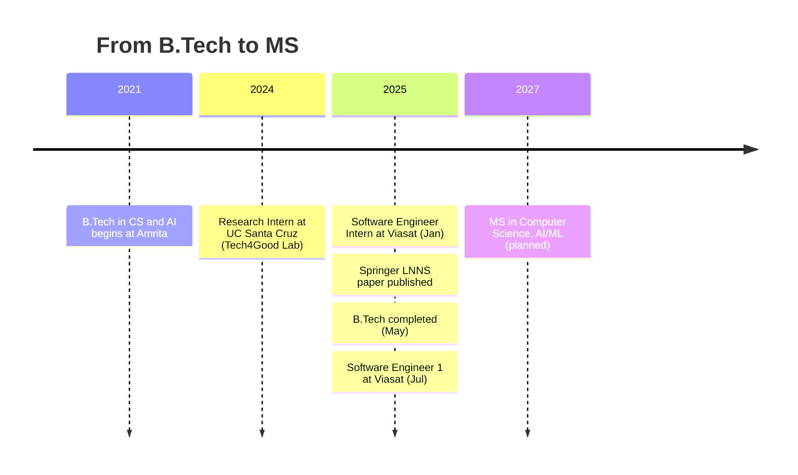
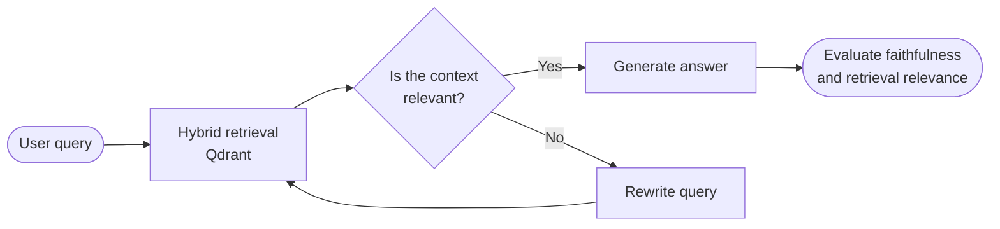

<h1 align="center">Aditya Vardhan Reddy</h1>

  <b>Software Engineer · AI/ML · Retrieval and Explainability</b>

  

  
  
  
  

I build cloud data governance and logging infrastructure on GCP at Viasat. Outside work I build AI systems and test them properly. I care about showing that a model or pipeline works, with evaluation, not just running it. I'm preparing to start an MS in Computer Science (AI/ML) in Fall 2027.

---

##  At a glance

<table align="center">
  <tr>
    <td align="center"><h3>8.72 / 10</h3>B.Tech CGPA Computer Science and AI</td>
    <td align="center"><h3>1</h3>Springer publication</td>
    <td align="center"><h3>0.58 → 0.62</h3>nDCG@10 gain from hybrid retrieval</td>
    <td align="center"><h3>68.7% → 78.2%</h3>accuracy gain from Bias-Aware Grad-CAM</td>
  </tr>
</table>

##  Journey

##  Projects

### Corrective RAG Engine
`LangGraph` `FastAPI` `Qdrant` `Streamlit` `Docker Compose`

A RAG system that checks its own retrieval before answering. It scores whether the retrieved context is relevant, rewrites the query when it isn't, and evaluates answer faithfulness and retrieval relevance.

### Incident Summarizer with Retrieval and Evaluation
`Python` `scikit-learn` `sentence-transformers`

Finds similar past outages and drafts a likely cause and fix, citing the incidents it used.

| | |
|---|---|
| **Compared** | BM25, TF-IDF, LSA, dense (MiniLM), hybrid |
| **Setup** | 100 labeled public post-mortems, leave-one-out, bootstrap confidence intervals |
| **Finding** | A BM25 + dense hybrid gave a small but reliable nDCG@10 gain over BM25 (0.58 → 0.62). Dense alone did not. |

### [Alzheimer's Disease Prediction](https://github.com/avr4324/ALZHEIMER-S-DISEASE-PREDICTION-USING-TRANSFER-LEARNING-AND-CNN)
`TensorFlow` `Keras` `InceptionV3`

A CNN with transfer learning that classifies brain MRI scans into four dementia stages, reaching 80.47% test accuracy and 81.30% validation AUC.

## 🔬 Research

**[Exploring Biases and Interpretability of Deep Learning Models](https://doi.org/10.1007/978-3-032-06694-7_46)**, Springer LNNS, 2025
A Bias-Aware Grad-CAM framework for ResNet race and gender classifiers on UTKFace. It measures how well the model's attention matches facial regions (IoU) and feeds that back into the loss, raising test accuracy from 68.7% to 78.2%.

**Research Intern, Tech4Good Lab, UC Santa Cruz**, summer 2024
AI-assisted ideation: detecting idea saturation and improving human-AI brainstorming through constraint-based prompting.

## 🛠 Skills

  

**Data:** BigQuery · Snowflake · Snowplow · Airflow · SQL

---

  <a href="https://linkedin.com/in/aditya-vardhan-reddy-a68822273">LinkedIn</a>
  &nbsp;·&nbsp;
  <a href="https://doi.org/10.1007/978-3-032-06694-7_46">Publication</a>

